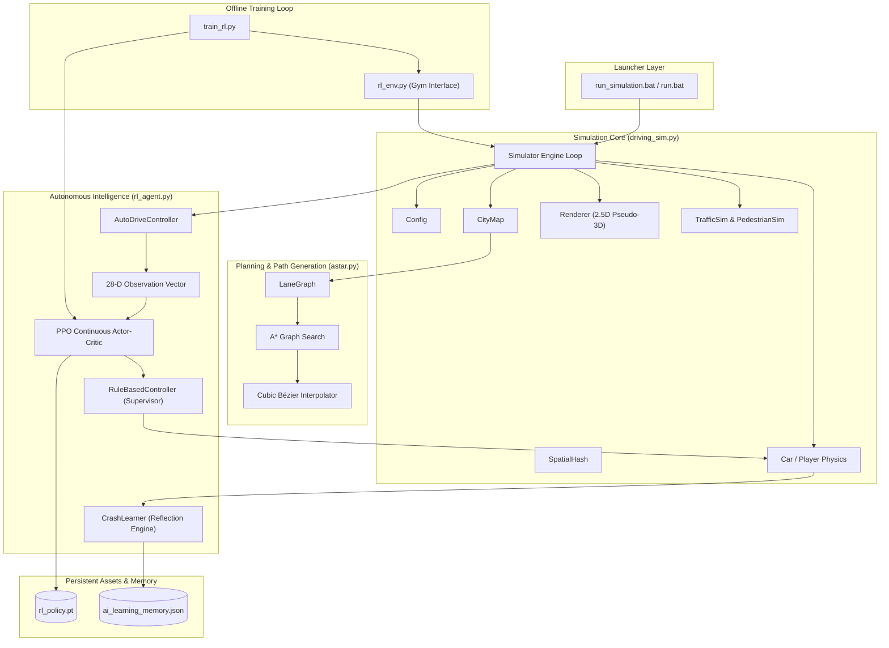

# Autonomous City Driving Simulator - Exhaustive Codebase Documentation

This document provides a comprehensive, section-by-section and function-by-function technical breakdown of every file in the project. It details the algorithms, mathematical models, data structures, and inter-file communication pipelines that power the autonomous vehicle simulation.

---

## Table of Contents
1. [Visual System Dependency & Data-Flow Graph](#1-visual-system-dependency--data-flow-graph)
2. [Module 1: `driving_sim.py` (Core Simulation & 3D Engine)](#2-module-1-driving_simpy-core-simulation--3d-engine)
3. [Module 2: `rl_agent.py` (Reinforcement Learning & Autopilot Layer)](#3-module-2-rl_agentpy-reinforcement-learning--autopilot-layer)
4. [Module 3: `astar.py` (Topological Routing & Bézier Curves)](#4-module-3-astarpy-topological-routing--bezier-curves)
5. [Module 4: `rl_env.py` (Gym-Compatible Training Harness)](#5-module-4-rl_envpy-gym-compatible-training-harness)
6. [Module 5: `train_rl.py` (PPO Rollout & Policy Optimizer)](#6-module-5-train_rlpy-ppo-rollout--policy-optimizer)
7. [Module 6: `test_features.py` (Automated Regression & Validation Suite)](#7-module-6-test_featurespy-automated-regression--validation-suite)
8. [Configuration & State Files](#8-configuration--state-files)

---

## 1. Visual System Dependency & Data-Flow Graph



---

## 2. Module 1: `driving_sim.py` (Core Simulation & 3D Engine)

[`driving_sim.py`](file:///c:/Users/Ayush%20C%20S/OneDrive/Desktop/simulation%20based%20self%20driving%20car/driving_sim.py) is the primary engine of the simulation, consisting of over 7,400 lines of high-performance Python code built without external 3D engines, utilizing pure math, Pygame drawing primitives, and spatial hashing.

### Section 1.1: Global Configuration (`Config`)
- `Config.SCREEN_WIDTH`, `Config.SCREEN_HEIGHT`: Default viewport resolution ($1280 \times 720$).
- `Config.PHYS_DT`: Fixed simulation physics step ($0.02\text{s} = 50\text{Hz}$).
- `Config.FOCAL_LENGTH`: Camera focal projection length ($380.0\text{px}$).
- `Config.HORIZON_Y`: Screen Y-coordinate for the vanishing point ($360.0\text{px}$).
- `Config.Z_NEAR`: Near clipping plane ($0.45\text{m}$) preventing division-by-zero during perspective division.
- `Config.GRID_N`: Dimension of the procedural road grid ($7 \times 7$ road blocks).
- `Config.BLOCK_MIN`, `Config.BLOCK_MAX`: Procedural block size variation ($140\text{m}$ to $220\text{m}$).

### Section 1.2: Spatial Indexing (`SpatialHash`)
- `SpatialHash(cell_size)`: Two-dimensional spatial hashing grid that partitions world geometry into $O(1)$ query buckets.
- `insert(item, x0, y0, x1, y1)`: Inserts a bounding box into all overlapping grid cells `(gx, gy)`.
- `query_box(x0, y0, x1, y1)`: Retrieves all unique objects within a rectangular coordinate query box using a deduplication set. Used for road surfaces, building rendering, traffic collisions, and bridge decks.

### Section 1.3: Procedural City Generator (`CityMap`)
- `_layout()`: Randomly assigns arterial highways, avenues, and local streets across grid rows and columns.
- `_build_graph()`: Constructs the topological graph of intersections (`Node`) and road segments (`Edge`).
- `_build_lanes()`: Generates continuous directed lane polylines with accurate lane offsets, median barriers, and curb boundaries.
- `_build_signals_and_crosswalks()`: Places synchronized 4-phase traffic light heads, stop lines, and pedestrian crosswalks.
- `_build_bridges()`: Synthesizes elevated multi-level flyovers (`DECK_H = 6.8\text{m}`) with approach ramps, support pillars, concrete parapets, and overhead lighting.
- `_clean_signs()`: Verifies that every roadside sign (speed limit, zebra crossing) is positioned strictly outside road asphalt on sidewalks and crosswalk boundaries with a minimum $1.4\text{m}$ clearance buffer.
- `_index_static()`: Populates spatial hash indices for fast static querying during runtime.

### Section 1.4: 2.5D Pseudo-3D Graphics Engine (`Renderer`)
- `_set_cam(x, y, yaw, h, horizon)`: Configures the 3D camera coordinate transformation matrix.
- `_to_cam(wx, wy)`: Converts world 2D coordinates into camera-relative coordinates:
  $$x_{cam} = -(wx - x_c) \sin(\psi) + (wy - y_c) \cos(\psi)$$
  $$z_{cam} = (wx - x_c) \cos(\psi) + (wy - y_c) \sin(\psi)$$
- `_quad3(pts, col)`: Projects 3D polygonal vertices to screen pixels using perspective projection:
  $$s_x = \frac{W}{2} + \frac{x_{cam} \cdot f}{z_{cam}}, \quad s_y = \text{horizon} + \frac{(\text{cam}_h - z_{world}) \cdot f}{z_{cam}}$$
  Includes Sutherland-Hodgman clipping against `Z_NEAR` and viewport edges.
- `_draw_pillar(p, dist)`: Renders ground support pillars under flyover decks; automatically suppresses rendering when the camera or vehicle is elevated on the flyover deck to prevent cap beams from clipping the road surface.
- `_draw_lamp(l, dist)`: Renders street lampposts; detects overhead bridge decks and suppresses ground poles underneath flyovers.
- `_draw_sign(s, dist)`: Projects metallic sign poles and circular speed limit or rectangular crosswalk badges.
- `_scene(sim, ...)`: Coordinates the global Painter's Algorithm depth sort (`objs.sort(key=lambda o: -o[0])`), drawing background sky, ground polygons, buildings, barriers, cars, pedestrians, and player vehicles in correct back-to-front depth order.

### Section 1.5: Vehicle Kinematics & Physics (`Car` & `Player`)
- `Car`: Dynamic vehicle state tracking $(x, y, z)$, heading angle, longitudinal velocity $v$, yaw rate $\dot{\theta}$, steering angle $\delta$, and vehicle dimensions.
- `step_physics(dt, steer_cmd, thr_cmd, brk_cmd)`: Integrates kinematic bicycle model equations, applies friction, engine braking, acceleration bounds, and guardrail collision deflection.
- `Player`: Extends `Car` with human keyboard input integration, manual reverse latching (`in_reverse`), cruise control, and Auto Drive status hooks.

### Section 1.6: Traffic & Pedestrian Simulation (`TrafficSim` & `PedestrianSim`)
- `TrafficSim`: Manages up to 150 background autonomous vehicles executing IDM car-following, lane tracking, traffic signal stops, and polite intersection yielding.
- `PedestrianSim`: Simulates animated pedestrians crossing crosswalks with realistic walking gait, shirt/pants coloring, and collision avoidance zones.

### Section 1.7: Simulation Orchestrator (`Simulator`)
- `run(max_frames)`: Core game loop executing input polling, physics updates, autonomous controller steps, camera updates, rendering passes, HUD overlays, and frame-rate regulation ($50\text{ FPS}$).
- `toggle_pause()`: Freezes simulation physics, timers, and traffic agents while maintaining full UI, camera, and map interactivity.
- `toggle_auto_drive()`: Safely engages or disengages the autonomous routing system.
- `_unpark_step(dt)`: Autonomous reverse-departure maneuver for backing out of parking stalls with rear cross-traffic sensing and a 2.0-second deadlock watchdog.

---

## 3. Module 2: `rl_agent.py` (Reinforcement Learning & Autopilot Layer)

[`rl_agent.py`](file:///c:/Users/Ayush%20C%20S/OneDrive/Desktop/simulation%20based%20self%20driving%20car/rl_agent.py) encapsulates the decision-making brain of the vehicle, housing the neural policy network, fallback controller, and online reflection memory.

### Section 2.1: Neural Architecture (`ActorCritic`)
- **Shared Representation**: Multi-Layer Perceptron (MLP) with two dense layers ($128 \times 128$) and $\text{Tanh}$ activations.
- **Actor Head**: Dedicated dense layer ($128 \to 64 \to 3$) outputting mean continuous action parameters:
  - Steering $\mu_{steer} \in [-1, 1]$ via $\text{Tanh}$.
  - Throttle $\mu_{thr} \in [0, 1]$ via $\text{Sigmoid}$.
  - Brake $\mu_{brk} \in [0, 1]$ via $\text{Sigmoid}$.
- **Critic Head**: Dedicated dense layer ($128 \to 64 \to 1$) outputting expected state-value estimate $V(s)$.

### Section 2.2: PPO Agent (`PPOAgent`)
- `select_action(obs, deterministic)`: Feeds observation vector through policy; samples from Gaussian distribution during training or returns deterministic mean during deployment.
- `evaluate_actions(obs, acts)`: Computes log-probabilities, state values, and entropy for PPO surrogate objective updates.
- `save(path)` / `load(path)`: Serializes and deserializes PyTorch weights to/from `rl_policy.pt`.

### Section 2.3: Deterministic Supervisor (`RuleBasedController`)
Acts as an indispensable ISO 26262-style functional safety layer running concurrently with the neural network:
- `supervise_action(sim, rl_action)`: Audits proposed neural actions against deterministic physics rules:
  1. Clamps throttle to $0.0$ and applies progressive braking if approaching a red traffic light or stop line.
  2. Applies IDM following distance deceleration if trailing a lead car within safety buffer distance.
  3. Executes emergency stops if a pedestrian steps into the active lane.
  4. Applies Stanley steering correction to prevent cornering boundary exceedance.
  5. **Sequential Curvature Tracking & U-Turn Kinematic Deceleration**: Slices upcoming route polyline waypoints, identifies $90^\circ$ corners and $180^\circ$ U-turns ($\Delta \theta > 1.25\text{ rad}$ or cumulative turn $> 1.6\text{ rad}$), clamps speed to $10\text{ km/h}$, and enforces progressive kinematic braking ($v = \sqrt{v_{corner}^2 + 2 a \Delta d}$) over a $45\text{m}$ horizon.
  6. **In-Lane Corridor Filtering & Anti-Deadlock Watchdog**: Limits lead vehicle tracking strictly to $|lat| \le 1.35\text{m}$ (ignoring side/adjacent cars). If held behind stationary traffic, stage 1 ($t > 2.0\text{s}$) initiates a gentle creeping nudge at $1.2\text{ m/s}$ ($4.3\text{ km/h}$) and stage 2 ($t > 4.5\text{s}$) forces an autonomous deadlock bypass at $2.5\text{ m/s}$ ($9\text{ km/h}$).
- Dynamic parameters (`min_corner_speed`, `pre_turn_horizon`, `restoring_torque_gain`, `following_buffer`) are loaded from `ai_learning_memory.json` and mutate during crash reflection.

### Section 2.4: Online Crash Reflection Engine (`CrashLearner`)
- `analyze_and_learn(sim, crash_type, partner)`: Triggered instantaneously on collision:
  1. Identifies error cause (guardrail impact, lead vehicle crash, oncoming lane intrusion).
  2. Increments `total_mistakes_learned` in `ai_learning_memory.json`.
  3. Adapts safety parameters (e.g., reduces cornering entrance speed by $0.15\text{ m/s}$, increases pre-turn lookahead by $1.5\text{m}$).
  4. Computes negative policy gradient updates to suppress the specific action that triggered the impact.

### Section 2.5: Autonomous Controller Facade (`AutoDriveController`)
- `compute_action(sim, dt)`: Compiles the 28-D observation vector, queries the neural policy, applies the safety supervisor, checks rear cross-traffic during reverse, and returns finalized $(steer, throttle, brake)$ commands to the vehicle physics engine.

---

## 4. Module 3: `astar.py` (Topological Routing & Bézier Curves)

[`astar.py`](file:///c:/Users/Ayush%20C%20S/OneDrive/Desktop/simulation%20based%20self%20driving%20car/astar.py) provides high-level topological road navigation and path smoothing.

### Section 3.1: Network Graph Representation (`LaneGraph`)
- `Node`: Represents an intersection or terminus with coordinates $(x, y)$, elevation, connecting legs, and traffic signal timing.
- `Edge`: Represents a directed road connection with length, curvature, speed limit, road category (highway, avenue, street, lane), and elevation profile.

### Section 3.2: $A^*$ Search Algorithm (`find_route`)
- Implements optimal graph search using a priority queue (`heapq`):
  $$f(n) = g(n) + h(n)$$
  - Cost $g(n)$: Accumulated travel time across road segments + turning angle penalty.
  - Heuristic $h(n)$: Euclidean distance from current node to destination divided by maximum city speed limit.
- Guarantees admissibility ($h(n) \le h^*(n)$) and consistency, ensuring the returned path is mathematically optimal in travel time.

### Section 3.3: Smooth Path Generation (`build_path_points`)
- Takes raw graph edges and generates a continuous sequence of closely spaced waypoints ($0.5\text{m}$ intervals).
- Computes cubic Bézier curve control points at junctions:
  $$\mathbf{B}(t) = (1-t)^3 \mathbf{P}_0 + 3(1-t)^2 t \mathbf{P}_1 + 3(1-t) t^2 \mathbf{P}_2 + t^3 \mathbf{P}_3$$
- Synthesizes smooth, continuous U-turn loops when departing dead-end landmark bays.

---

## 5. Module 4: `rl_env.py` (Gym-Compatible Training Harness)

[`rl_env.py`](file:///c:/Users/Ayush%20C%20S/OneDrive/Desktop/simulation%20based%20self%20driving%20car/rl_env.py) implements the OpenAI Gym interface for training reinforcement learning agents.

### Section 4.1: Environment Class (`CityDrivingEnv`)
- `__init__(seed, headless, traffic_count)`: Instantiates a headless `Simulator` instance with isolated RNG.
- `observation_space`: `Box(low=-inf, high=inf, shape=(28,), dtype=float32)`.
- `action_space`: `Box(low=[-1.0, 0.0, 0.0], high=[1.0, 1.0, 1.0], dtype=float32)`.

### Section 4.2: Step & Transition Logic (`step`)
- `step(action)`: Translates action vector into vehicle steering, throttle, and brake; steps physics by `Config.PHYS_DT`; detects collisions; compiles reward; returns `(next_obs, reward, terminated, truncated, info)`.

### Section 4.3: Reward Engineering (`_calculate_reward`)
- Rewards forward progress along route: $R_{prog} = +1.2 \cdot \frac{v \cos(\theta_e)}{v_{limit}}$.
- Penalizes lateral deviation: $R_{lat} = -0.8 \cdot (e_{lat} / w_{lane})^2$.
- Penalizes heading misalignment: $R_{head} = -0.4 \cdot (1 - \cos \theta_e)$.
- Penalizes overspeeding: $R_{speed} = -1.5 \cdot \max(0, v - v_{limit})$.
- Terminal penalty on collision: $R_{crash} = -100.0$.

---

## 6. Module 5: `train_rl.py` (PPO Rollout & Policy Optimizer)

[`train_rl.py`](file:///c:/Users/Ayush%20C%20S/OneDrive/Desktop/simulation%20based%20self%20driving%20car/train_rl.py) executes continuous PPO policy training.

### Section 5.1: Rollout Buffer & Advantage Estimation (`RolloutBuffer`)
- Stores states $s_t$, actions $a_t$, rewards $r_t$, state values $V_t$, log-probabilities $\log \pi_t$, and terminal masks $d_t$.
- Computes Generalized Advantage Estimation (GAE):
  $$\delta_t = r_t + \gamma V(s_{t+1}) (1 - d_t) - V(s_t)$$
  $$\hat{A}_t = \sum_{l=0}^\infty (\gamma \lambda)^l \delta_{t+l}$$

### Section 5.2: Optimization Epochs (`train_ppo`)
- Mini-batch stochastic gradient descent optimizing clipped surrogate loss + value function MSE loss - entropy bonus:
  $$\mathcal{L}_{total} = \mathcal{L}_{CLIP}(\theta) + c_1 \mathcal{L}_{VF}(\phi) - c_2 \mathcal{S}[\pi_\theta]$$
- Employs Adam optimizer with learning rate $\alpha = 3 \times 10^{-4}$ and gradient clipping ($\|\nabla\| \le 0.5$).
- Automatically saves trained weights into `rl_policy.pt`.

---

## 7. Module 6: `test_features.py` (Automated Regression & Validation Suite)

[`test_features.py`](file:///c:/Users/Ayush%20C%20S/OneDrive/Desktop/simulation%20based%20self%20driving%20car/test_features.py) is the master verification test harness containing 11 automated suites:
1. `test_pause_freezes_simulation()`: Validates that pausing freezes physics, vehicle speed, and world time.
2. `test_auto_drive_and_destinations()`: Verifies $A^*$ route planning across all 7 landmark destinations.
3. `test_manual_override_cancellation()`: Ensures user steering or throttle input immediately disengages Auto Drive.
4. `test_mutual_exclusion()`: Guarantees Auto Drive and CNN sensor autopilot cannot run simultaneously.
5. `test_safety_layer_red_light()`: Verifies that the safety supervisor overrides full throttle at red traffic signals.
6. `test_full_headless_run()`: Runs a complete 60-frame headless simulation run across procedural cities.
7. `test_mistake_learning_and_adaptation()`: Verifies that collisions dynamically increment lifetime mistake counters and adapt controller parameters in `ai_learning_memory.json`.
8. `test_unpark_watchdog_and_override()`: Confirms that unparking yields to rear cross-traffic and the 2.0s watchdog breaks deadlocks.
9. `test_grass_offroad_recovery()`: Verifies forward and reverse mobility and throttle recovery on off-road grass terrain.
10. `test_uturn_speed_reduction()`: Validates that approaching a $180^\circ$ U-turn loop triggers active braking and safely limits speed to $\le 10\text{ km/h}$.
11. `test_traffic_deadlock_watchdog_and_side_car_filtering()`: Confirms that side vehicles in adjacent lanes do not trigger false braking, and the two-stage watchdog initiates creeping ($2.0\text{s}$) and bypass ($4.5\text{s}$) nudges.

---

## 8. Configuration & State Files

### `ai_learning_memory.json`
Stores persistent learning statistics and adapted controller weights across sessions:
```json
{
  "total_mistakes_learned": 332,
  "adapted_parameters": {
    "min_corner_speed": 3.45,
    "pre_turn_horizon": 36.0,
    "restoring_torque_gain": 0.43,
    "following_buffer": 2.2
  },
  "history": [ ... ]
}
```

### `requirements.txt`
Dependencies required to execute the simulation and training pipelines:
```
pygame>=2.6.0
torch>=2.0.0
numpy>=1.24.0
```

### `run_simulation.bat` & `run.bat`
Native Windows command batch scripts that verify Python installation in system `PATH` or local virtual environment (`.venv`) and launch `driving_sim.py` with error pausing.
