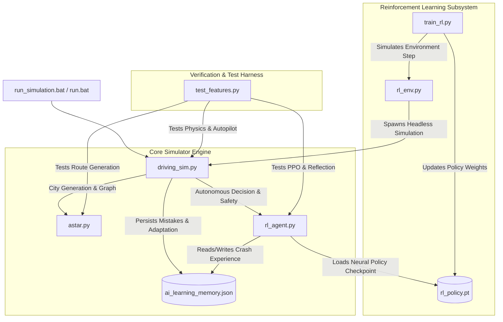
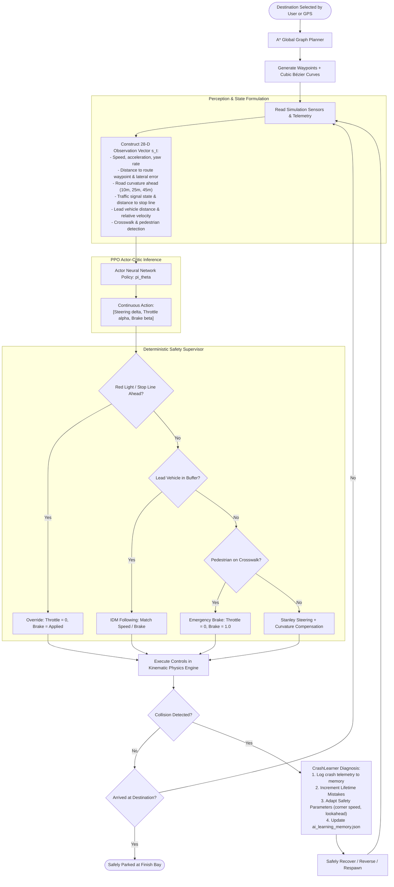

# Autonomous City Driving Simulator with Reinforcement Learning & A* Navigation

An advanced, full-stack autonomous driving simulation environment built from scratch in Python and Pygame, featuring procedural 3D cities, elevated multi-level flyovers, dynamic traffic and pedestrians, continuous PPO (Proximal Policy Optimization) Actor-Critic neural control, hybrid $A^*$ global route planning, and active online crash reflection learning.

---

## Table of Contents
1. [Overview & Key Features](#overview--key-features)
2. [Project Architecture & File Directory](#project-architecture--file-directory)
3. [Visual Dependency Graph](#visual-dependency-graph)
4. [Autonomous Navigation Flowchart](#autonomous-navigation-flowchart)
5. [Mathematical Formulations](#mathematical-formulations)
   - [Kinematic Bicycle Model](#1-kinematic-bicycle-model)
   - [Stanley Lateral Steering Controller](#2-stanley-lateral-steering-controller)
   - [Pure Pursuit Steering Geometry](#3-pure-pursuit-steering-geometry)
   - [Longitudinal Speed Control & IDM Car Following](#4-longitudinal-speed-control--idm-car-following)
   - [Cubic Bézier Transition Curves](#5-cubic-bézier-transition-curves)
   - [Sequential Curvature Tracking & Kinematic U-Turn Deceleration](#6-sequential-curvature-tracking--kinematic-u-turn-deceleration)
   - [Anti-Deadlock Queue Watchdog & In-Lane Corridor Filtering](#7-anti-deadlock-queue-watchdog--in-lane-corridor-filtering)
   - [Surface Drag & Off-Road Grass Mobility](#8-surface-drag--off-road-grass-mobility)
6. [Reinforcement Learning System (PPO Actor-Critic)](#reinforcement-learning-system-ppo-actor-critic)
   - [Continuous Action & Observation Space](#observation-space-mathcal-s-in-mathbbr28)
   - [PPO Clipped Objective & Value Function](#ppo-clipped-surrogate-objective)
   - [Comprehensive Reward Function](#reward-formulation)
   - [Online Crash Reflection & Dynamic Learning](#online-crash-reflection--dynamic-adaptation)
7. [Global Graph Routing (A^* Algorithm)](#global-graph-routing-a-algorithm)
8. [Installation & Quickstart Guide](#installation--quickstart-guide)
9. [Controls & In-Game Telemetry](#controls--in-game-telemetry)

---

## Overview & Key Features

- **Procedural 3D City Engine**: Unlimited random urban environments with multi-lane highways, tree-lined avenues, residential streets, realistic intersections, crosswalks, traffic signals, and elevated multi-level flyovers with solid concrete ramps and parapets.
- **Hybrid Autonomous Architecture**: Combines global graph-level topological route finding ($A^*$) with local continuous Actor-Critic neural policies (PPO) and a deterministic safety supervision layer.
- **Online Crash Reflection & Dynamic Adaptation**: When an impact occurs, the system logs the failure, increments a persistent lifetime mistake counter in `ai_learning_memory.json`, dynamically adjusts controller parameters (cornering speeds, lookahead, following buffers), and backpropagates localized policy gradient penalties.
- **Smart Unparking & Reversing**: Autonomous back-out maneuvers when departing destinations with cross-traffic proximity detection and dead-lock prevention watchdogs.
- **Multi-Camera & Sensor Suite**: First-person cockpit view, third-person chase camera, top-down tactical map, rear-view mirror, and a 200×66 forward CNN vehicle perception feed.

---

## Project Architecture & File Directory

```
simulation-based-self-driving-car/
│
├── driving_sim.py           # Core simulator: 3D projection, physics, city generation, traffic AI, UI
├── rl_agent.py              # PPO Actor-Critic neural network, RuleBasedController, CrashLearner
├── astar.py                 # Topological road-network routing, cubic Bézier lane transitions, U-turns
├── rl_env.py                # Gym-compatible Reinforcement Learning training environment
├── train_rl.py              # PPO training pipeline with rollout collection and GAE calculation
├── test_features.py         # Automated 11-suite regression and validation test harness
├── run_simulation.bat       # One-click Windows execution batch script
├── run.bat                  # Quick execution alias batch script
├── requirements.txt         # Python package dependencies (pygame, torch, numpy)
├── rl_policy.pt             # Pre-trained PyTorch Actor-Critic weights (obs_dim=28, act_dim=3)
├── ai_learning_memory.json  # Persistent memory storing lifetime mistake count and adapted parameters
├── README.md                # Architectural, mathematical, and algorithmic documentation
└── CODE_EXPLAINED.md        # Comprehensive file-by-file code reference
```

---

## Visual Dependency Graph



### Why Files Connect:
- **`driving_sim.py` $\leftrightarrow$ `astar.py`**: The simulation provides topological road nodes and directed lane segments. `astar.py` calculates optimal shortest paths through the city network and synthesizes smooth Bézier connector points so vehicles turn seamlessly.
- **`driving_sim.py` $\leftrightarrow$ `rl_agent.py`**: In every simulation frame, `driving_sim.py` compiles a 28-dimensional normalized sensor vector $\mathbf{s}_t$ and feeds it to `AutoDriveController` in `rl_agent.py`. The controller passes it through the neural network and the deterministic safety supervisor, returning continuous steering, throttle, and brake values.
- **`rl_agent.py` $\leftrightarrow$ `ai_learning_memory.json`**: When collisions or near-misses occur, `CrashLearner` records the error diagnostic, increments the lifetime mistake counter, adapts parameters (such as `min_corner_speed` and `following_buffer`), and writes them to JSON.
- **`train_rl.py` $\leftrightarrow$ `rl_env.py` $\leftrightarrow$ `rl_policy.pt`**: `train_rl.py` coordinates PPO training over thousands of episodes in headless mode via `rl_env.py`, saving trained Actor-Critic weights into `rl_policy.pt`.

---

## Autonomous Navigation Flowchart



---

## Mathematical Formulations

### 1. Kinematic Bicycle Model
Vehicle motion is modeled using standard non-linear kinematic bicycle equations centered at the rear axle:

$$\dot{x} = v \cos(\theta)$$

$$\dot{y} = v \sin(\theta)$$

$$\dot{\theta} = \frac{v}{L} \tan(\delta)$$

$$\dot{v} = a_{throttle} - a_{brake} - a_{drag}$$

Where:
- $(x, y)$: Cartesian coordinates of the vehicle rear axle in meters.
- $\theta$: Vehicle yaw heading angle in radians.
- $v$: Longitudinal forward velocity in $\text{m/s}$.
- $\delta$: Front wheel steering angle ($-\delta_{max} \le \delta \le \delta_{max}$).
- $L$: Wheelbase length ($2.6\text{m}$ for sedan, $3.2\text{m}$ for SUV, $2.0\text{m}$ for auto-rickshaw).
- $a_{drag}$: Combined aerodynamic drag and rolling resistance: $a_{drag} = c_{roll} \cdot g + \frac{1}{2} \rho C_d A v^2$.

---

### 2. Stanley Lateral Steering Controller
The lateral trajectory tracker uses the front-axle Stanley control law, which eliminates both heading error and cross-track error asymptotically:

$$\delta(t) = \theta_e(t) + \arctan\left(\frac{k_e \cdot e_{lat}(t)}{v(t) + \epsilon}\right) + k_{soft} \cdot \dot{e}_{lat}(t)$$

Where:
- $\theta_e = \theta_{path} - \theta_{car}$: Heading error between vehicle body and the tangent of the target path segment.
- $e_{lat}$: Signed cross-track error measuring perpendicular lateral distance from the front axle to the nearest path center point.
- $k_e$: Lateral gain parameter (adapted dynamically based on speed: $k_e \approx 0.85$).
- $\epsilon = 0.5\text{ m/s}$: Softening parameter preventing singularity as velocity approaches zero.
- $k_{soft} \cdot \dot{e}_{lat}$: Derivative damping term preventing high-speed oscillatory weaving.

---

### 3. Pure Pursuit Steering Geometry
For sharp intersections and 90-degree cornering, Pure Pursuit provides robust path convergence:

$$\delta = \arctan\left(\frac{2 L \sin(\alpha)}{L_{lookahead}}\right)$$

Where:
- $\alpha$: Angle between the current heading vector and the line connecting the rear axle to the lookahead goal point $(x_g, y_g)$.
- $L_{lookahead}$: Dynamic speed-dependent lookahead distance:
  $$L_{lookahead} = \max\left(L_{min}, \, k_{look} \cdot v\right)$$
  With $L_{min} = 3.5\text{m}$ and $k_{look} = 0.45\text{s}$.

---

### 4. Longitudinal Speed Control & IDM Car Following
Longitudinal acceleration combines closed-loop target velocity PID control with the Intelligent Driver Model (IDM) for vehicle following:

$$a_{IDM} = a_{max} \left[ 1 - \left(\frac{v}{v_0}\right)^4 - \left(\frac{s^*(v, \Delta v)}{s}\right)^2 \right]$$

The desired dynamic gap $s^*$ is defined as:

$$s^*(v, \Delta v) = s_0 + v \cdot T + \frac{v \cdot \Delta v}{2 \sqrt{a_{max} \cdot b_{comf}}}$$

Where:
- $v_0$: Free-flow speed limit of the current road segment.
- $s$: Actual distance to the lead vehicle.
- $s_0$: Jam distance ($2.5\text{m}$ minimum stationary buffer).
- $T$: Safe time headway ($1.4\text{s}$).
- $\Delta v = v - v_{lead}$: Approaching velocity difference.
- $a_{max}$: Maximum comfortable acceleration ($2.5\text{ m/s}^2$).
- $b_{comf}$: Comfortable deceleration ($3.0\text{ m/s}^2$).

---

### 5. Cubic Bézier Transition Curves
Intersections and U-turn arcs are smoothly interpolated using parametric cubic Bézier curves:

$$\mathbf{B}(t) = (1-t)^3 \mathbf{P}_0 + 3(1-t)^2 t \mathbf{P}_1 + 3(1-t) t^2 \mathbf{P}_2 + t^3 \mathbf{P}_3, \quad t \in [0, 1]$$

Where:
- $\mathbf{P}_0$: Departure point from incoming lane.
- $\mathbf{P}_1 = \mathbf{P}_0 + d \cdot \hat{\mathbf{u}}_{in}$: First control point aligned with incoming road tangent.
- $\mathbf{P}_2 = \mathbf{P}_3 - d \cdot \hat{\mathbf{u}}_{out}$: Second control point aligned with outgoing road tangent.
- $\mathbf{P}_3$: Arrival point on target receiving lane.
- $d = \frac{1}{3} \|\mathbf{P}_3 - \mathbf{P}_0\|$: Tangent handle distance ensuring continuous curvature ($G^1$ geometric continuity).

---

### 6. Sequential Curvature Tracking & Kinematic U-Turn Deceleration
To eliminate high-speed cornering understeer and guardrail impacts during sharp $90^\circ$ turns and $180^\circ$ U-turns, the controller analyzes an upcoming ordered slice of path waypoints:

$$\mathbf{S}_{upcoming} = \{\mathbf{p}_i \in \text{nav\_route\_pts} \mid i \in [k_{closest}, k_{closest} + 40]\}$$

For each segment $(\mathbf{p}_{j}, \mathbf{p}_{j+1})$, the segment heading is computed as $\psi_j = \text{atan2}(y_{j+1} - y_j, x_{j+1} - x_j)$. The maximum heading deviation $\Delta \theta_{max}$ and cumulative curvature $\sum \Delta \psi$ classify turn sharpness:

$$\text{is\_u\_turn} = \left( \Delta \theta_{max} > 1.25\text{ rad} \; (72^\circ) \quad \lor \quad \sum_{j} |\psi_{j+1} - \psi_j| > 1.60\text{ rad} \; (90^\circ\text{ to }180^\circ) \right)$$

Safe cornering speed $v_{corner}$ and kinematic deceleration profiles are enforced before reaching the corner entrance:

$$v_{target}(d) = \min\left(v_{posted}, \, \sqrt{v_{corner}^2 + 2 \cdot a_{comfort} \cdot \max(0, d_{turn} - 1.5)}\right)$$

Where:
- $v_{corner} = 2.78\text{ m/s}$ ($10\text{ km/h}$) for U-turns and hairpin loops with an extended $45\text{m}$ horizon.
- $v_{corner} = 3.8\dots4.2\text{ m/s}$ ($14\dots15\text{ km/h}$) for sharp $90^\circ$ corners with a $32\text{m}$ horizon.
- $a_{comfort} = 1.5\text{ m/s}^2$: Kinematic braking deceleration preventing sudden shock while guaranteeing entry speed is strictly $\le 10\text{ km/h}$.

---

### 7. Anti-Deadlock Queue Watchdog & In-Lane Corridor Filtering
To prevent phantom freeze states where stationary side vehicles, parked curbside cars, or cross traffic falsely lock the brakes:

1. **Tight Lateral Corridor Filtering**:
   Only vehicles sharing the same lane corridor ($|e_{lat}| \le 1.35\text{m}$) are recognized as lead vehicles:
   $$e_{lat} = - (x_{car} - x) \sin(\theta) + (y_{car} - y) \cos(\theta)$$
   Vehicles in adjacent lanes ($|e_{lat}| > 1.5\text{m}$), parked vehicles, and oncoming opposite-lane traffic ($e_{lat} < -1.0\text{m}$) are completely excluded from lead braking logic.

2. **Two-Stage Deadlock Watchdog**:
   If the vehicle is held in standstill behind a lead obstruction ($v \approx 0$):
   $$\tau_{stop} \leftarrow \tau_{stop} + \Delta t$$
   - **Stage 1 (Creep Nudge)**: If $\tau_{stop} > 2.0\text{s}$ and physical clearance $s > 1.2\text{m}$, the vehicle releases brakes and creeps forward at $v = 1.2\text{ m/s}$ ($4.3\text{ km/h}$).
   - **Stage 2 (Bypass Nudge)**: If $\tau_{stop} > 4.5\text{s}$ (traffic permanently stalled/deadlocked) and $s > 0.8\text{m}$, the vehicle initiates an autonomous bypass at $v = 2.5\text{ m/s}$ ($9\text{ km/h}$).

---

### 8. Surface Drag & Off-Road Grass Mobility
When a vehicle drives off-road onto green grass terrain, realistic mobility is preserved using physical surface drag rather than artificial immobilizing stops:

$$F_{drag} = \mu_{surface} \cdot m \cdot g + \frac{1}{2} \rho C_d A v^2$$

- On asphalt ($surface = 1, 2$): $\mu_{surface} = 0.015$.
- On grass / green areas ($surface = 0$): $\mu_{surface} = 0.020$ ($1.35\times$ rolling resistance).
- Off-road top speed is naturally limited to $25\text{ km/h}$ while full engine torque in both forward ($u_{throttle} = 1.0$) and reverse ($u_{reverse} = 1.0$) remains active, enabling smooth, uninterrupted recovery back onto paved asphalt.

---

## Reinforcement Learning System (PPO Actor-Critic)

### Observation Space ($\mathcal{S} \in \mathbb{R}^{28}$)
Each frame, the agent observes a normalized 28-dimensional state vector:
1. $v / v_{max}$: Normalized longitudinal speed.
2. $a / a_{max}$: Normalized acceleration.
3. $e_{lat} / w_{lane}$: Lateral distance offset from target path center.
4. $\sin(\theta_e), \cos(\theta_e)$: Heading angle error relative to route.
5. $\kappa_{10}, \kappa_{25}, \kappa_{45}$: Road curvature at 10m, 25m, and 45m ahead.
6. $v_{limit} / 100$: Speed limit of the active road segment.
7. $d_{stop} / 50$: Distance to approaching traffic stop line.
8. $I_{red}, I_{yellow}, I_{green}$: One-hot traffic signal encoding.
9. $d_{lead} / 60$: Distance to front lead vehicle.
10. $\Delta v_{lead} / 20$: Relative velocity to front vehicle.
11. $d_{ped} / 30$: Distance to nearest pedestrian on path.
12. $I_{flyover}$: Binary elevation indicator ($1.0$ if on ramp/bridge deck).
13. $w_{curb\_L}, w_{curb\_R}$: Distance to left and right road curbs.
14. Action feedback: Previous frame steering, throttle, and brake values.

---

### Continuous Action Space ($\mathcal{A} \in \mathbb{R}^3$)
The Actor outputs three bounded continuous control signals:
- Steering: $u_{steer} \in [-1.0, 1.0] \implies \delta = u_{steer} \cdot \delta_{max}$
- Throttle: $u_{throttle} \in [0.0, 1.0] \implies a_{thr} = u_{throttle} \cdot a_{max}$
- Brake: $u_{brake} \in [0.0, 1.0] \implies a_{brk} = u_{brake} \cdot b_{max}$

---

### PPO Clipped Surrogate Objective
The neural policy parameters $\theta$ are updated using Proximal Policy Optimization:

$$L^{CLIP}(\theta) = \hat{\mathbb{E}}_t \left[ \min\left( r_t(\theta) \hat{A}_t, \, \text{clip}(r_t(\theta), 1-\epsilon, 1+\epsilon) \hat{A}_t \right) \right]$$

Where:
- Probability ratio: $r_t(\theta) = \frac{\pi_\theta(a_t | s_t)}{\pi_{\theta_{old}}(a_t | s_t)}$.
- Generalized Advantage Estimator (GAE): $\hat{A}_t = \sum_{l=0}^\infty (\gamma \lambda)^l \delta_{t+l}^V$.
- Temporal Difference residual: $\delta_t^V = r_t + \gamma V_\phi(s_{t+1}) - V_\phi(s_t)$.
- Policy clipping parameter: $\epsilon = 0.20$.

The Critic network minimizes Mean Squared Error against discounted returns:

$$L^{VF}(\phi) = \hat{\mathbb{E}}_t \left[ \left( V_\phi(s_t) - R_t \right)^2 \right]$$

---

### Reward Formulation
The scalar reward $R_t$ incentivizes rapid, safe, and comfortable progress:

$$R_t = R_{progress} - R_{lateral} - R_{heading} - R_{overspeed} - R_{jerk} - R_{infraction}$$

$$\begin{aligned}
R_{progress} &= +1.2 \cdot \frac{v \cos(\theta_e)}{v_{limit}} \cdot \Delta t \\
R_{lateral} &= -0.8 \cdot \left(\frac{e_{lat}}{w_{lane}}\right)^2 \\
R_{heading} &= -0.4 \cdot (1 - \cos \theta_e) \\
R_{overspeed} &= -1.5 \cdot \max(0, \, v - v_{limit}) \\
R_{jerk} &= -0.05 \cdot (|\Delta \delta| + |\Delta u_{thr}| + |\Delta u_{brk}|) \\
R_{crash} &= -100.0 \quad (\text{terminates episode on collision})
\end{aligned}$$

---

### Online Crash Reflection & Dynamic Adaptation
The simulator features an active online reflection engine that updates on every impact without losing stability:
1. **Root-Cause Classification**: When collision triggers, the agent classifies the incident into Guardrail Impact, Lead Vehicle Rear-End, Oncoming Lane Intrusion, or Cross-Traffic Collision.
2. **Lifetime Mistake Tracking**: Increments `total_mistakes_learned` and records telemetry in `ai_learning_memory.json`.
3. **Adaptive Controller Mutations**:
   - Guardrail Impact $\implies$ Tightens lookahead distance, lowers maximum corner entrance speed, increases restoring torque gain.
   - Lead Car Impact $\implies$ Expands following buffer distance $s_0$, increases headway $T$.
   - Opposite Lane Intrusion $\implies$ Increases lateral restoring weight, strictly enforces centerline boundaries.

---

## Global Graph Routing ($A^*$ Algorithm)

Global navigation treats the road network as a directed weighted graph $G = (V, E)$, where:
- Vertices $V$: Road junctions, intersections, and landmark terminal bays.
- Edges $E$: Directed lanes with speed limits, road types (highway, avenue, street, lane), and physical lengths.

The optimal route minimizes total traversal time:

$$f(n) = g(n) + h(n)$$

$$g(n) = \sum_{e \in \text{path}} \frac{\text{length}(e)}{v_{limit}(e)} + \text{cost}_{turn}(e_{prev}, e_{next})$$

$$h(n) = \frac{\|\mathbf{x}_n - \mathbf{x}_{goal}\|}{v_{max\_city}}$$

The turn penalty $\text{cost}_{turn}$ penalizes sharp turns and U-turns unless necessary, favoring wide, free-flowing avenues and multi-lane highways.

---

## Installation & Quickstart Guide

### Prerequisites
- Windows 10/11
- Python 3.10, 3.11, or 3.12
- Graphics: Any modern GPU/iGPU supporting hardware-accelerated 2D blitting

### Step 1: Install Dependencies
Open PowerShell or Command Prompt in the repository folder:
```bash
pip install -r requirements.txt
```

### Step 2: Launch the Simulator
Run the one-click Windows launcher:
```bash
run_simulation.bat
```
*(Or simply type `run.bat` or `python driving_sim.py`)*

### Step 3: Run the Full Test Harness
Execute all 11 automated verification test suites:
```bash
python test_features.py
```

---

## Controls & In-Game Telemetry

| Key / Control | Function | Description |
| :--- | :--- | :--- |
| **W / S** | Throttle / Brake | Accelerate and brake (hold S at standstill to reverse) |
| **A / D** | Steering | Steer wheels left / right |
| **O** / UI Button | **AUTO DRIVE** | Toggle Autonomous A* + RL Autopilot |
| **TAB** / UI Button | **PAUSE** | Freeze simulation physics, timers, and traffic |
| **1 - 7** | Select Landmark | Route to: Airport, Hospital, Mall, Skyscraper, Market, Bus Terminus, Station |
| **G** | Cycle GPS | Cycle to the next GPS landmark destination |
| **M** | Map View | Open full-screen city map with clickable navigation sidebar |
| **V** | Camera View | Cycle: First-person cockpit $\leftrightarrow$ Chase camera $\leftrightarrow$ Top-down view |
| **B** | Rear Camera | Toggle rear-view camera window in top center |
| **X** | Vehicle Switch | Switch vehicle: Sedan, SUV, Auto-Rickshaw, Motorcycle, Scooter |
| **T** | Time of Day | Cycle lighting: Day $\leftrightarrow$ Sunset $\leftrightarrow$ Night |
| **N** | Next Spawn | Jump vehicle to the next city spawn location |
| **K** | New City | Procedurally generate an entirely new random city layout |
| **ESC** | Exit | Safely close simulation session and print summary |
